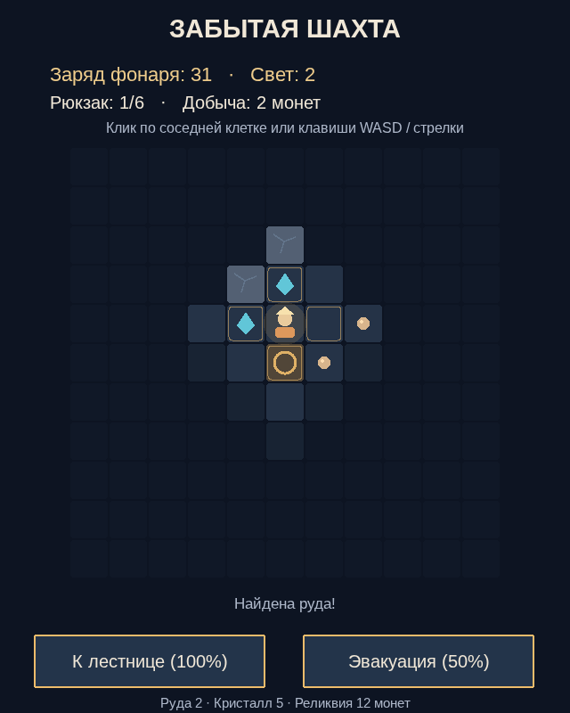

# Последний фонарь

**[Играть в браузере](https://romansachkovskiy.github.io/last-lantern/)**

Спускайся в шахту, собирай кристаллы и возвращайся к лестнице, пока в фонаре есть заряд. За добычу можно улучшить фонарь, аккумулятор, кирку и рюкзак. В каждой экспедиции тебя ждёт новая шахта.

Управление — WASD, стрелки или нажатие на соседнюю клетку.

## Права

© 2026 Roman Sachkovskiy. Все права защищены. Подробности в [LICENSE](LICENSE).
